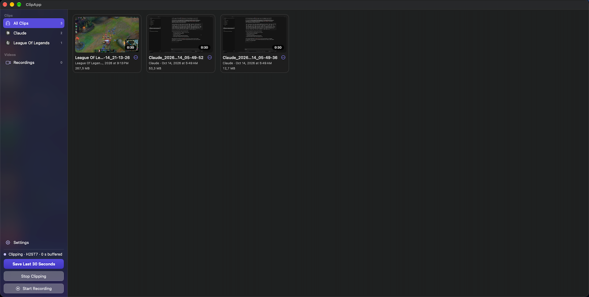
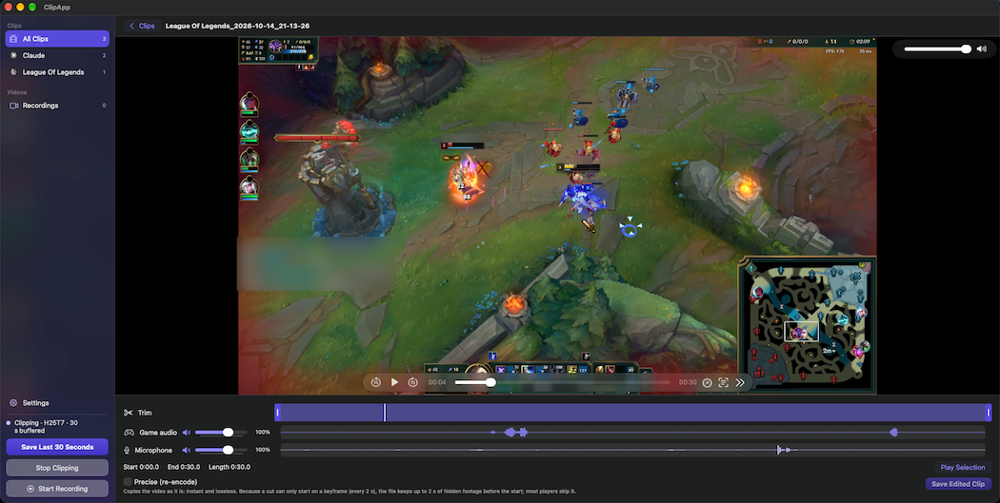

# ClipApp

<p align="center">
  
</p>

<p align="center">
  
</p>

<p align="center">
  
  
  
</p>

An "instant replay" clipping app for macOS (the Medal / ShadowPlay idea). Start clipping and ClipApp keeps the last N seconds of your screen in memory; press a shortcut and they are saved as an mp4. Clips are sorted by game, played, trimmed and re-balanced in the app's window. Closing the window leaves ClipApp in the menu bar.

The interface is in English by default. Türkçe için: Settings > General > Language.

## Features

- **Start / Stop Clipping.** Capture runs only when you ask for it: Start Clipping (sidebar or menu bar) starts the replay buffer, Stop Clipping empties it and stops capture, so no CPU is used and the screen recording indicator is off. Settings > General > Start clipping when ClipApp opens starts it at launch (off by default, also applies at login).
- **Save the last N seconds** (15–120 s) with a global shortcut (default ⌃⌥⌘R), the sidebar or the menu. Captures a display, a window or an application, with hardware H.264 encoding.
- **Clip library by game.** Clips go to `Clips/<game>/` and are named `<game>_<date>_<time>.mp4` automatically, the game being the app in front (or the one you just left). The sidebar lists every game with its icon; rename, move to another game, reveal in Finder, copy or trash one clip or a selection.
- **Trimming.** Pick a range under the player and save as a new clip or over the original, either losslessly or re-encoded to the exact range.
- **Separate audio levels.** System audio and microphone are mixed for every player and also kept as separate tracks, so the editor can change their balance (0–150 % or mute) after the fact.
- **Recording.** Start/Stop Recording records for as long as you like into `Videos/`, written to disk as it goes so a crash does not lose it. It works with clipping on or off.
- **Menu bar control.** The menu shows the status and offers save, start/stop clipping and recording, the capture source and the audio switches. The icon is dimmed while clipping is off and shows a red dot while recording.
- **Permissions in Settings.** Screen Recording, Microphone and Notifications are listed with their state and the button that fixes them.
- **Show ClipApp in recordings.** ClipApp's own windows and notification banners stay out of clips by default; turn this on in Settings > General to include ClipApp (for a tutorial, say). The short on-screen message never appears in clips.
- English and Turkish, switchable without a restart.

## Requirements

- macOS 13+
- Xcode 15+ and [XcodeGen](https://github.com/yonaskolb/XcodeGen) (`brew install xcodegen`)

## Download

Get the latest dmg from [Releases](https://github.com/ozturkmert1212/clip-app/releases/latest). Apple Silicon only, macOS 13 or later.

The release is signed with a Developer ID and notarized by Apple: just open the dmg and drag ClipApp to Applications. Grant Screen Recording when asked (Settings > Permissions in ClipApp), then restart ClipApp.

After an update macOS may ask for the permissions again (always when updating from 0.2.0 or earlier, whose builds were signed differently).

## Updates

From 0.3.0 on, ClipApp updates itself through [Sparkle](https://sparkle-project.org): it looks for a new version when it opens and every few hours, and asks before installing it. If you are looking at ClipApp's window, the update window comes up right away; otherwise (ClipApp in the background, its window closed, clipping or a recording running) it waits for you as "Update available" at the top of the menu bar menu and above Settings in the window, plus one notification per version if notifications are allowed. Use Check for Updates… in the menu bar menu or in Settings > Updates to look right away, or turn off the automatic checks there. Nothing about your Mac is sent with the check. Updates are signed, and ClipApp only installs one that carries the project's signature.

0.2.1 and earlier have no updater: download 0.3.0 once from [Releases](https://github.com/ozturkmert1212/clip-app/releases/latest) and replace the old app in Applications. Later versions then arrive on their own.

## Build and install

```bash
xcodegen generate
xcodebuild -project ClipApp.xcodeproj -scheme ClipApp -configuration Release -derivedDataPath build build
cp -R build/Build/Products/Release/ClipApp.app /Applications/
open /Applications/ClipApp.app
```

For development, build with `-configuration Debug` and open `build/Build/Products/Debug/ClipApp.app`. "Launch at login" can only be turned on in the copy in `/Applications`.

## Permissions

All permissions are listed under Settings > Permissions with their current state and a button to request them or to open the right page of System Settings. If Screen Recording is missing, the app opens there.

- **Screen Recording (required):** Requested from that row or by the first Start Clipping. After granting it, restart the app (the row offers a button).
- **Microphone (optional):** Requested when the microphone is turned on. Without it, clips have system audio only.
- **Notifications (optional):** Requested at first launch. macOS hides banners while the screen is being captured; to see them, turn on "Allow notifications when mirroring or sharing the display" under System Settings > Notifications (the row links there). The on-screen message works either way.

## Language

English is the default, whatever the system language. Turkish is under Settings > General > Language and applies at once; text supplied by macOS (the app menu, the shortcut field) follows after a restart.

## Known limits

- Nothing can be clipped before Start Clipping: with clipping off there is no buffer. Turn on "Start clipping when ClipApp opens" to have it from launch.
- The shortcut may not work in games running in exclusive fullscreen; use borderless or windowed mode.
- Notification Center is excluded from display capture to keep banners out of clips, so desktop widgets do not appear either.
- The separate audio tracks are marked disabled; a player that ignores that and plays every track would play the audio doubled.
- On content that barely compresses (heavy noise, grain) the encoder overshoots the bitrate; memory is capped, so such clips come out shorter than configured and the menu says so.
- Microphone and system audio at different sample rates cannot be mixed; such a clip has two plain tracks and cannot be re-balanced in the editor.

## Troubleshooting

App logs: `/usr/bin/log show --predicate 'subsystem == "com.mertozturk.ClipApp"' --last 5m --info`

See `CLAUDE.md` for an architecture overview and development notes.

## Building from source

`project.yml` contains the author's `DEVELOPMENT_TEAM` and `bundleIdPrefix`. Replace both with your own before building (your Team ID is the `OU=` value of your "Apple Development" certificate, also shown in Xcode > Settings > Accounts). Without a stable signing identity, macOS may ask for the Screen Recording permission again after every rebuild. A build of your own still checks this project's update feed (`SUFeedURL` and `SUPublicEDKey` in `project.yml`); change or remove both if you distribute it.

If you would rather not build it yourself, a prebuilt dmg is available under [Releases](https://github.com/ozturkmert1212/clip-app/releases/latest), see "Download" above.

## Running the tests

```bash
scripts/test.sh
```

Runs the XCTest suite and prints each test class with the result and the totals. The tests do not launch ClipApp and need no permission or device: synthetic pictures and tones go through the real encoder and writers and the files are checked with AVFoundation. Run one class or test with, for example, `scripts/test.sh ClipAppTests/TrimTests`.

## License

MIT, see `LICENSE`.
