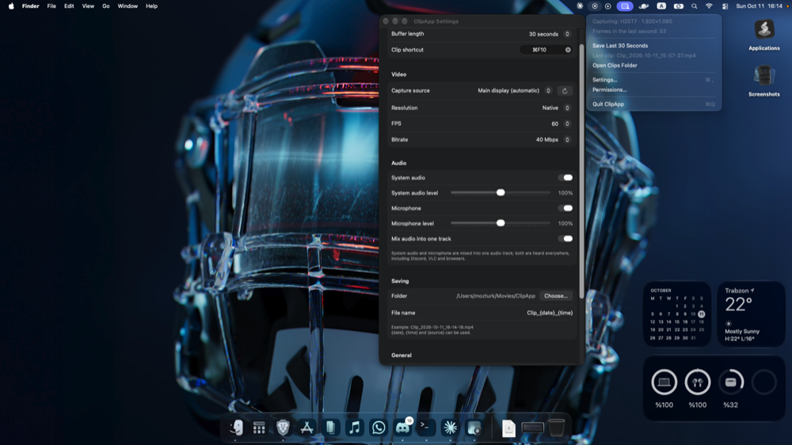
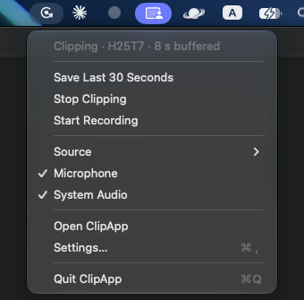
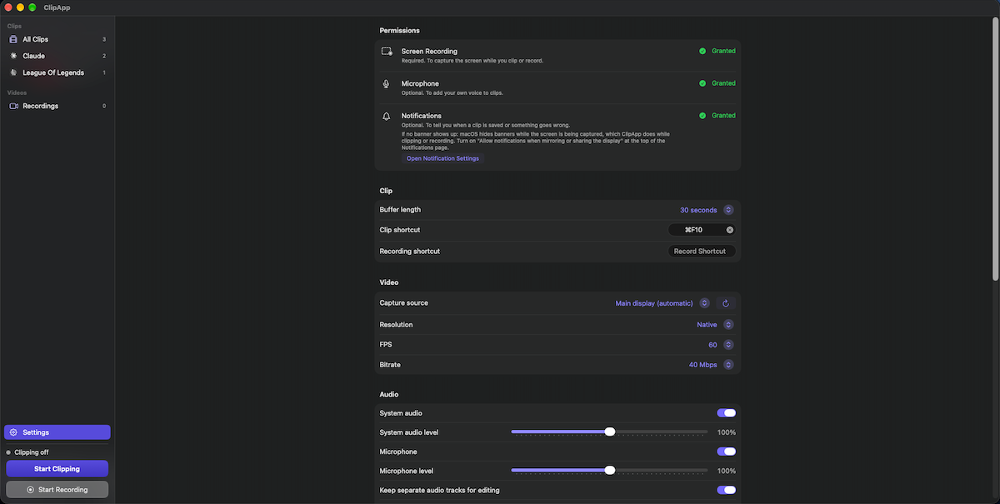
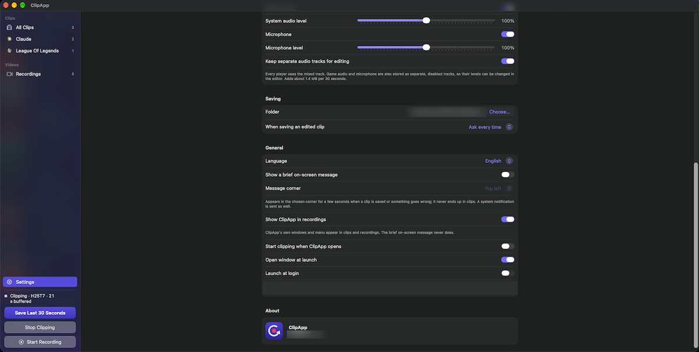

# ClipApp

<p align="center">
  
</p>

<p align="center">
  
</p>

<p align="center">
  
  
</p>

An "instant replay" clipping app for macOS (the Medal / ShadowPlay idea). It captures the screen in the background, keeps the last N seconds in memory and saves them as an mp4 when you press a global shortcut. Saved clips are listed, played and trimmed in the app's window; closing the window leaves ClipApp running in the menu bar.

The interface is in English by default. Türkçe için: Settings > General > Language.

## Features

- Continuous screen capture (a display, a single window or a single application), hardware H.264 encoding, a 15–120 second buffer in memory.
- Save the last N seconds as an mp4 with a global shortcut (default ⌃⌥⌘R) or from the menu; capture keeps running while the clip is written. Clips are filed and named by game: `Clips/<game>/<game>_<date>_<time>.mp4` under the save folder, the game being the app in front (or the one you just left, when ClipApp itself is in front).
- Record for as long as you like with Start/Stop Recording (menu, sidebar or a shortcut you assign in Settings). Recordings go to `Videos/` as `Recording_<date>_<time>.mp4`, are written straight to disk in fragments so a crash does not lose them, and the replay buffer keeps working meanwhile.
- System audio and microphone, each with its own level. Every file gets a mixed audio track that all players use; game audio and microphone are also stored as separate, disabled tracks so their balance can be changed later (can be turned off in Settings).
- A system notification when a clip is saved or something goes wrong (the notification reveals the clip in Finder), plus a small on-screen message in a corner of the screen for a few seconds. The message never ends up in clips and also shows above full screen games; its corner is chosen in Settings (default top left) and it can be turned off.
- System notifications (banners) and ClipApp's own windows stay out of clips while a display is captured. To show ClipApp in your clips and recordings (for a tutorial, say), turn on Settings > General > Show ClipApp in recordings; it takes effect at once without clearing the buffer or stopping a recording. The brief on-screen message stays out either way.
- A clip library: thumbnails grouped by game in the sidebar, newest first, with rename, move to another game, reveal in Finder, copy and move to Trash, for one clip or a selection (⌘-click, ⇧-click, ⌘A). Double-click a clip to play it.
- Editing: pick a range under the player and set the level of game audio and microphone separately (0–150 %, or mute) while listening. Save as a new file or over the original; the video is copied losslessly, or re-encoded to exactly the selected range.
- Settings: buffer length, resolution, FPS, bitrate, source, audio, save folder, showing ClipApp in recordings, launch at login, language (English or Turkish).

## Requirements

- macOS 13+
- Xcode 15+ and [XcodeGen](https://github.com/yonaskolb/XcodeGen) (`brew install xcodegen`)

## Download

Grab the latest dmg from [Releases](https://github.com/ozturkmert1212/clip-app/releases/latest). Requires an Apple Silicon Mac with macOS 13 or later.

The app is not notarized, so macOS blocks the first launch: open System Settings > Privacy & Security and click **Open Anyway** next to ClipApp (or run `xattr -dr com.apple.quarantine /Applications/ClipApp.app`). Then grant Screen Recording and restart the app.

## Build and install

```bash
xcodegen generate
xcodebuild -project ClipApp.xcodeproj -scheme ClipApp -configuration Release -derivedDataPath build build
cp -R build/Build/Products/Release/ClipApp.app /Applications/
open /Applications/ClipApp.app
```

While developing, build with `-configuration Debug` and open `build/Build/Products/Debug/ClipApp.app` directly. "Launch at login" can only be turned on in the copy inside `/Applications`, because the login item is registered for wherever the app currently is.

## Permissions

All permissions are listed under Settings > Permissions with their current state and a button to request them or to open the right page of System Settings. If Screen Recording is missing, the app opens there.

- **Screen Recording (required):** Requested from that row. After granting it under System Settings > Privacy & Security > Screen Recording, restart the app (the row offers a button).
- **Microphone (optional):** Requested when the microphone is turned on, in Settings or in the menu. Without it, clips are saved with system audio only.
- **Notifications (optional):** Requested at first launch. macOS hides notifications by default while the screen is shared or recorded; since ClipApp captures the screen all the time, turn on "Allow notifications when mirroring or sharing the display" under System Settings > Notifications if you want to see the banners. The row has a button that takes you there. That switch cannot be flipped from code, so the on-screen message works independently of it.

## Language

English is the default, regardless of the system language. Turkish can be selected under Settings > General > Language and applies at once; text that macOS supplies (the app menu, the shortcut field) follows after the restart offered there.

## Known limits

- To keep notifications out of clips, Notification Center is excluded from capture; desktop widgets belong to it too, so they do not appear in display clips. With a single window or application as the source, only that application is captured anyway.
- The global shortcut may not work in games that run in exclusive fullscreen. Use borderless or windowed mode in the game's display settings.
- The separate game audio and microphone tracks are marked disabled, so players use the mixed track; a player that ignores that flag and plays every track at once would play the audio doubled.
- On content that is very hard to compress (heavy noise, grainy footage) the encoder overshoots the target bitrate. Memory is capped at buffer length × bitrate × 3; once the cap is hit, clips come out shorter than configured and the menu shows an info line.
- If microphone and system audio arrive at different sample rates they cannot be mixed and are written as two ordinary tracks; such a clip cannot be re-balanced in the editor.

## Troubleshooting

App logs: `/usr/bin/log show --predicate 'subsystem == "com.mertozturk.ClipApp"' --last 5m --info`

See `CLAUDE.md` for an architecture overview and development notes.

## Building from source

`project.yml` contains the author's `DEVELOPMENT_TEAM` and `bundleIdPrefix`. Replace both with your own before building (your Team ID is the `OU=` value of your "Apple Development" certificate, also shown in Xcode > Settings > Accounts). Without a stable signing identity, macOS may ask for the Screen Recording permission again after every rebuild.

If you would rather not build it yourself, a prebuilt dmg is available under [Releases](https://github.com/ozturkmert1212/clip-app/releases/latest), see "Download" above.

## Running the tests

```bash
scripts/test.sh
```

Runs the XCTest suite with `xcodebuild test` and prints which test classes passed, any failing assertions, and the totals. The tests do not launch ClipApp and need no permission: the media tests feed synthetic pictures and tones through the real encoder and writers and check the resulting files with AVFoundation. Pass a class or a single test to run only that, for example `scripts/test.sh ClipAppTests/TrimTests`.

## License

MIT, see `LICENSE`.
